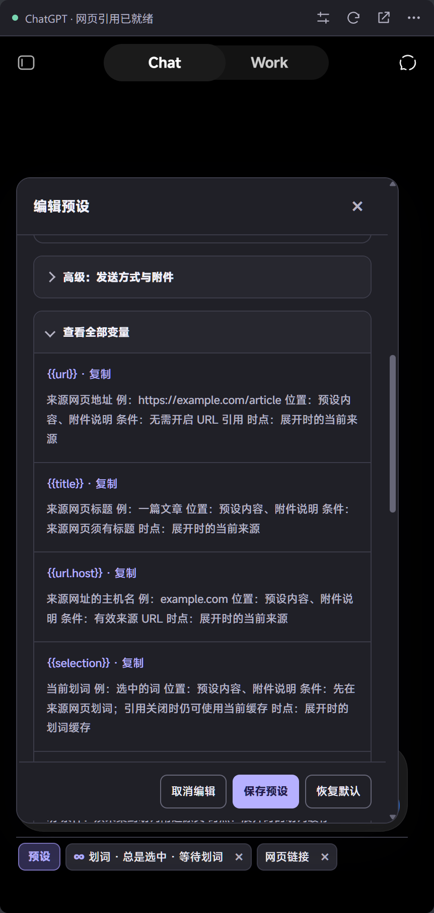
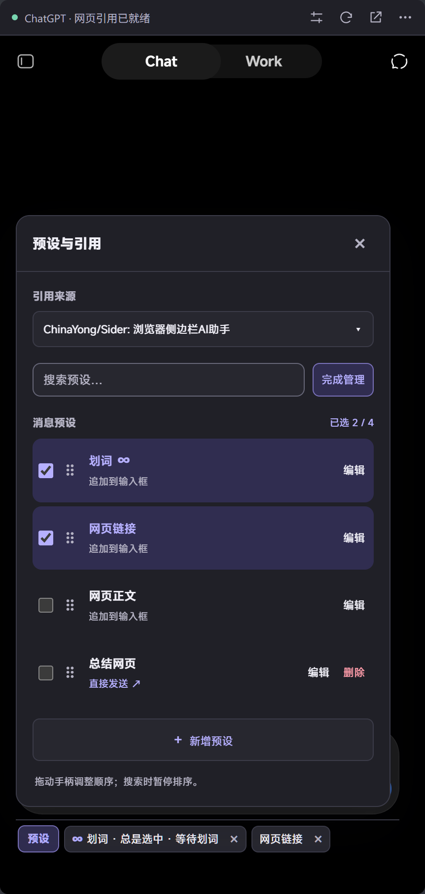
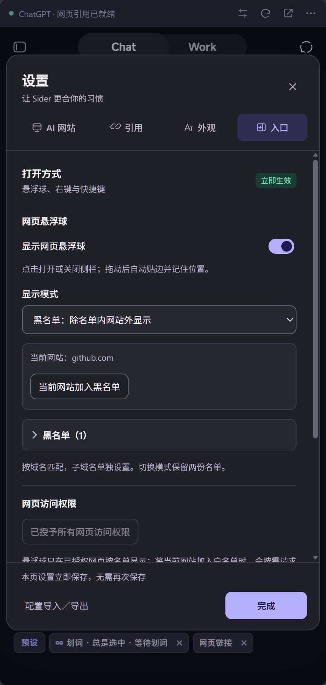
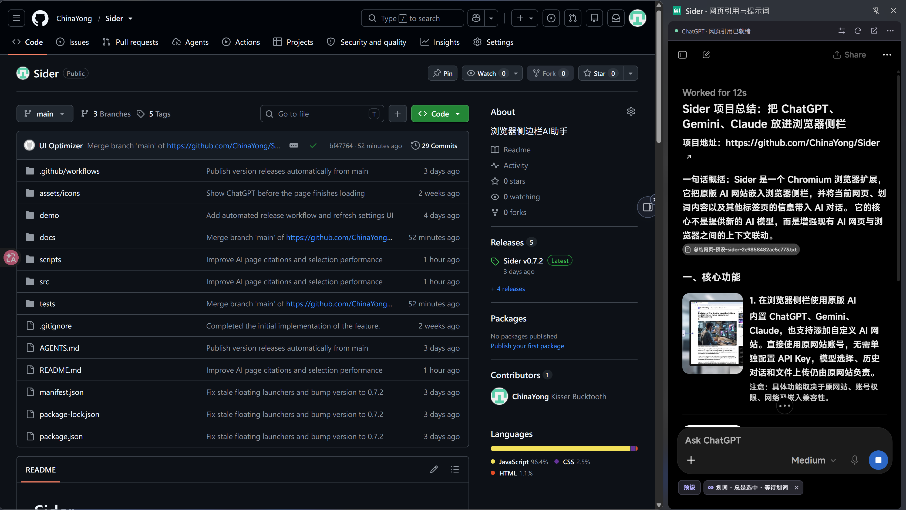

# Sider

**充分利用模型提供商的 Web 页面**

Sider 是一个 Chromium 浏览器扩展，把 ChatGPT、Gemini、Claude 等原版 AI 网站放进浏览器侧栏。
通过一个薄增强层让 AI Web 页面快速访问浏览器的网页信息，从而便利的让网页 AI 获取浏览器上下文以方便做出相关提问。

**使用已有的 AI 网站账号，无需 API Key。** 模型选择、历史对话和文件上传继续由原站提供，Sider 负责把网页里的材料带进你的提问。

[安装扩展](#安装) · [详细使用指南](docs/usage.md)

## Sider 的功能
> 内置 **ChatGPT、Gemini、Claude**，也支持添加自定义 AI 网站。Gemini 还可以设置默认界面为普通／Spark ，以及默认模型和思考等级；实际可用功能取决于原站和你的账号。

### 支持变量的提示词预设
> 预设功能是本插件的核心功能，通过支持变量的预设，让用户能够极便利的减少常用语或句式的输入。

#### 变量：
支持的变量：
- 网页地址
- 网页标题
- 网址域名
- 当前的网页划词
- 当前网页划词及其周边段落
- 本机日期
- 本机时间
- 本机日期时间
- 正文相关信息（如果有）
- 完整正文
- 附件文件名
- 当前预设名称



#### 其他相关预设功能：
- 支持预设点击直接发送，常用于总结网页
- 支持预设默认选中，自动附加网页信息
- 支持引用其他浏览器标签页（屏蔽了一些页面）



### 其他功能
- 更换字体
- 悬浮球（仅用于开关扩展）
- 其他功能可自行探索



## 效果

## 安装

需要支持原生侧栏的 Chromium 浏览器，例如 Chrome、Edge 或 Tabbit，最低要求 **Chromium 145**，并且能够访问你选择的 AI 网站。

### 下载扩展包

1. 在 [Releases](https://github.com/ChinaYong/Sider/releases) 下载 **`Sider-v*.zip`** 并解压。请选择扩展附件；GitHub 自动提供的 **Source code** 是源码归档。
2. 打开 `chrome://extensions/` 或 `edge://extensions/`，开启 **开发者模式**。
3. 点击 **加载已解压的扩展**，选择解压后包含 `manifest.json` 的目录。

请保留这个目录，浏览器会持续从中读取扩展。更新时，将新版解压到原加载目录，在扩展管理页点击 **重新加载**，然后关闭旧侧栏并重开。

<details>
<summary>从源码构建</summary>

准备好 Node.js、npm 和 Git，在终端执行：

```sh
git clone https://github.com/ChinaYong/Sider.git
cd Sider
npm ci
npm run build
```

然后按上面的步骤加载项目中的 **`dist/`** 目录。每次更新源码后重新构建，再到扩展管理页重新加载。`npm run build` 生成可加载目录，不生成 ZIP。

</details>

## 数据与访问范围

网页材料在浏览器内采集，选中的引用会随你发送的问题或附件交给当前 AI 网站。网站、预设等设置保存在浏览器本地，划词和正文快照等临时材料保存在浏览器会话中。配置备份不包含原站登录、聊天记录、草稿或网页材料。

扩展按需请求网页访问权限；列出标签页标题和网址用于选择引用来源，读取正文仍需对应网页的访问权。为让 AI 网站在侧栏加载，扩展会对侧栏中已登记 AI 网站的子框架响应调整 CSP 和 X-Frame-Options 嵌入限制。

正文采集只覆盖**已加载的网页主要内容**，不包含未加载段落、其他 iframe、图片或 Canvas 中的文字。浏览器内部页不能作为引用来源。在 ChatGPT 等 AI 网站标签页手动打开 Sider，也能引用当前页的划词；其他 AI 标签页仍默认不作为来源，自动划词入口和悬浮球设置独立生效。


## 注意
网站能否嵌入、登录或上传，取决于原站页面、网络和账号状态。自定义网站也需要满足这些条件。更多操作见 [使用指南](docs/usage.md)，测试覆盖与实际网站验证范围见 [验证记录](docs/validation.md)。

## 开发与贡献

项目使用 **Manifest V3、原生 JavaScript 和 esbuild**，正文提取基于 **Readability + Turndown**。网页采集、预设与变量展开共用一套流程，各网站适配层负责连接原站输入框、附件和发送控件。

```sh
npm ci                  # 安装锁定版本的依赖
npm run build           # 构建 dist/
npm test                # 运行单元测试
npm run test:browser     # 构建并运行隔离浏览器回归
npm run check           # 单元测试与构建
npm run dev             # 启动安装提示和示例文章页面
```

完整侧栏需要在浏览器中加载扩展；`npm run dev` 提供辅助调试页面。隔离浏览器测试的环境准备见 [浏览器测试说明](docs/browser-tests.md)，版本管理与 GitHub Actions 自动打包见 [发布说明](docs/releasing.md)。`dist/` 和扩展 ZIP 均为生成产物，不随源码提交。
